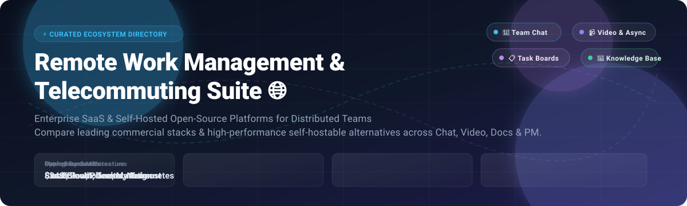

# Awesome Remote Work Management & Telecommuting Suite 🌐

<p align="center">
  
</p>

<p align="center">
  <a href="https://github.com/ishandutta2007/Awesome-Awesome-Awesome"></a><a href="https://discord.gg/jc4xtF58Ve"></a>
  <a href="https://github.com/ishandutta2007/Awesome-Remote-Work-Management-Telecommuting-Suite/stargazers"></a>
  <a href="https://github.com/ishandutta2007/Awesome-Remote-Work-Management-Telecommuting-Suite/network/members"></a>
  <a href="https://github.com/ishandutta2007/Awesome-Remote-Work-Management-Telecommuting-Suite/blob/main/LICENSE"></a>
  <a href="https://github.com/ishandutta2007"></a>
</p>

> 🌟 **A curated directory of top Remote Work Management and Telecommuting Suite platforms** — featuring battle-tested commercial SaaS solutions and self-hostable open-source alternatives for team chat, HD video conferencing, agile task management, collaborative docs, infinite whiteboards, and asynchronous video collaboration across distributed organizations.  
> 
> 💡 *Empowering hybrid teams, digital nomads, and engineering hubs to scale productivity without vendor lock-in!*  
> 🌟 **Star this repo if you find it helpful!** 🌟

---

## 🧭 Table of Contents 📑

- [📈 Sector Overview & Market Dynamics](#-sector-overview--market-dynamics)
- [🏢 SaaS / Hosted Commercial Platforms](#-saas--hosted-commercial-platforms)
- [🔓 Open-Source Software Stacks](#-open-source-software-stacks)
- [📊 Feature Matrix & Comparison at a Glance](#-feature-matrix--comparison-at-a-glance)
- [💡 Architectural Trade-offs & Selection Guide](#-architectural-trade-offs--selection-guide)
- [🤝 Contributing](#-contributing)
- [💖 Support & Sponsorship](#-support--sponsorship)
- [📈 Star History](#-star-history)
- [📄 License](#-license)

---

## 📈 Sector Overview & Market Dynamics 🌐

The global **Remote Work Management and Collaboration Software** market is estimated at **$24.8 billion** and projected to exceed **$58.5 billion by 2030**, advancing at a robust compound annual growth rate (CAGR) of ~13.2%.

The sector is **moderately fragmented yet dominated by entrenched ecosystem anchors**: hyper-scalers (Microsoft Teams bundled into M365) and enterprise giants (Salesforce Slack, Zoom) capture high-volume enterprise spend, while best-of-breed specialized suites (Notion for modular documentation, Monday.com/Asana for workflow management, Miro for visual whiteboards) thrive through bottom-up product-led growth (PLG) alongside an increasingly capable, privacy-centric open-source self-hosted ecosystem.

---

## 🏢 SaaS / Hosted Commercial Platforms ☁️

Cloud-hosted, enterprise-grade telecommuting suites and collaboration platforms. Ranked and sorted in **descending order by company scale (market capitalization / enterprise valuation)**.

| Platform 🚀 | Primary Focus 🎯 | Scale / Valuation 💰 | Starting Tier Pricing 💳 | Free Tier Limits / Free Trial Policy 🎁 | Deployment ☁️ |
|:---|:---|:---|:---|:---|:---|
| **Microsoft Teams** | Collaboration hub, VoIP, chat & video meetings | **~$3,100 Billion** (Microsoft Corp. Market Cap) | **$4.00/user/month** (Teams Essentials, annual commitment) | **Free forever plan**: Unlimited 1:1 meetings up to 30 hrs, group meetings up to 60 mins with 100 participants, 5 GB cloud storage/user, unlimited chat. | Cloud (M365 Hosted) |
| **Slack** | Channel-based team messaging & workflow automation | **~$27.7 Billion** (Acquired by Salesforce for $27.7B) | **$7.25/user/month** (Pro plan billed annually, or $8.75 monthly) | **Free forever plan**: 90-day searchable message and file history, 10 app integrations, 1:1 audio/video Huddles with screen sharing. | Cloud Multi-tenant |
| **Zoom Workplace** | Unified video conferencing, phone & webinars | **~$22.5 Billion** (Public Market Cap NASDAQ: ZM) | **$13.33/user/month** ($159.90/user/year for Pro tier, or $15.99 monthly) | **Free forever plan**: 40-minute limit per group meeting with up to 100 participants; unlimited 1:1 meetings; 3 editable whiteboards. | Cloud Global Infrastructure |
| **Notion** | All-in-one modular workspace, docs, wikis & databases | **~$10.0 Billion** (Private Valuation) | **$8.00/user/month** (Plus plan billed annually, or $10 monthly) | **Free forever plan**: Unlimited blocks for individuals, up to 10 guest collaborators, 5 MB file upload limit, basic page history. | Cloud AWS / Multi-tenant |
| **Monday.com** | Work OS with visual customizable boards & automations | **~$9.5 Billion** (Public Market Cap NASDAQ: MNDY) | **$9.00/seat/month** (Basic tier billed annually, min 3 seats = $27/mo) | **Free forever plan**: Strictly up to 2 seats/users, up to 3 boards, 200+ templates, 500 MB storage. (14-day Pro trial available). | Cloud Multi-tenant |
| **Miro** | Collaborative infinite whiteboard & visual ideation canvas | **~$17.5 Billion** (Private Valuation at peak funding round) | **$8.00/member/month** (Starter plan billed annually, or $10 monthly) | **Free forever plan**: 3 editable boards, unlimited viewers, access to 2500+ templates, core integrations (Slack, Drive, Zoom). | Cloud AWS Multi-tenant |
| **Asana** | Enterprise work management, Gantt timelines & projects | **~$2.9 Billion** (Public Market Cap NYSE: ASAN) | **$10.99/user/month** (Starter plan billed annually, or $13.49 monthly) | **Free forever plan (Personal)**: Up to 10 teammates, unlimited tasks, projects, messages, activity log, and 100+ free integrations. | Cloud AWS Hosted |
| **Loom** | Asynchronous screen & webcam video messaging | **~$975 Million** (Acquired by Atlassian for $975M) | **$12.50/creator/month** (Business plan billed annually, or $15 monthly) | **Free forever plan (Starter)**: Up to 25 videos per creator, up to 5 minutes max recording duration per video, 720p HD resolution. | Cloud AWS Hosted |
| **Basecamp** | Opinionated project communication, to-dos & message boards | **~$100+ Million** (Bootstrapped / Profitable 37signals valuation estimate) | **$15.00/user/month** (Basecamp per-user plan, or $299/mo fixed unlimited) | **30-day full-featured free trial** with no credit card required, including unlimited projects, storage, and all collaborative features. | Hybrid Cloud / Bare Metal |

---

## 🔓 Open-Source Software Stacks 💻

Self-hosted, transparent, and sovereignty-preserving telecommuting suites. Ranked in **descending order by GitHub Stars_Count**. Each badge links directly to the project's stargazers page.

### 1. [Excalidraw](https://github.com/excalidraw/excalidraw) [](https://github.com/excalidraw/excalidraw/stargazers) 🎨
- **Category:** Virtual Whiteboard & Architecture Diagramming  
- **Tech Stack:** TypeScript / React / Web Canvas  
- **License:** MIT  
- **Overview:** Excalidraw is the premier open-source virtual whiteboard for sketching hand-drawn-feel wireframes, architecture blueprints, flowcharts, and brainstorming sessions. Features end-to-end encryption for live multiplayer collaboration, zero tracking, rich export formats (PNG, SVG, clipboard), and modular npm component packaging (`@excalidraw/excalidraw`) for seamless embedding.  
- **Best For:** Distributed software engineers, system architects, and UX teams looking for zero-latency, private diagramming.

---

### 2. [AppFlowy](https://github.com/AppFlowy-IO/AppFlowy) [](https://github.com/AppFlowy-IO/AppFlowy/stargazers) 📝
- **Category:** Modular Workspace & Knowledge Base (Notion Alternative)  
- **Tech Stack:** Flutter / Rust / SQLite / Go  
- **License:** AGPL-3.0  
- **Overview:** Built as a secure, fast, and local-first alternative to Notion. AppFlowy combines cross-platform native clients (Windows, macOS, Linux, iOS, Android) with versatile database views (Grid, Kanban, Calendar), custom document blocks, offline persistence, and privacy-preserving cloud sync capabilities.  
- **Best For:** Knowledge workers and privacy-conscious teams needing a customizable offline-first documentation platform.

---

### 3. [AFFiNE](https://github.com/toeverything/AFFiNE) [](https://github.com/toeverything/AFFiNE/stargazers) 🧠
- **Category:** Hybrid Document & Infinite Canvas Workspace  
- **Tech Stack:** TypeScript / Rust (OctoBase CRDT) / React  
- **License:** MIT  
- **Overview:** AFFiNE converges documents, markdown wikis, and infinite whiteboards into an integrated canvas workspace. Users switch effortlessly between a structured text editor (like Notion) and an unbounded spatial canvas (like Miro). Includes offline-first CRDT synchronization, vector diagrams, and local LLM/custom API integrations.  
- **Best For:** Creative teams, agile product managers, and researchers needing spatial thinking alongside formal wikis.

---

### 4. [Plane](https://github.com/makeplane/plane) [](https://github.com/makeplane/plane/stargazers) 🎯
- **Category:** Modern Issue & Project Tracking (Linear & Jira Alternative)  
- **Tech Stack:** Python (Django) / TypeScript / Next.js / PostgreSQL / Redis  
- **License:** AGPL-3.0  
- **Overview:** Plane is an open-source project management suite built for agile product teams. Provides multi-view project boards (Kanban, List, Calendar, Gantt), cycle tracking, module management, page documentation, customer triage workflows, and time-tracking analytics with an interface rivaling Linear and Asana.  
- **Best For:** Modern software engineering organizations migrating away from heavy Jira or paid Linear setups.

---

### 5. [Rocket.Chat](https://github.com/RocketChat/Rocket.Chat) [](https://github.com/RocketChat/Rocket.Chat/stargazers) 💬
- **Category:** Omnichannel Team Communication & Secure Chat  
- **Tech Stack:** TypeScript / Node.js / MongoDB / React  
- **License:** MIT (Community Edition)  
- **Overview:** A battle-tested communications hub offering team channels, direct messaging, audio/video conferencing, voice notes, matrix federation, and omnichannel customer bridges (WhatsApp, SMS, Email). Engineered with enterprise-grade compliance, HIPAA/GDPR readiness, and on-premise governance.  
- **Best For:** Organizations with rigorous data-sovereignty mandates, healthcare providers, and high-security enterprises.

---

### 6. [Outline](https://github.com/outline/outline) [](https://github.com/outline/outline/stargazers) 📚
- **Category:** Team Knowledge Base & Documentation Wiki  
- **Tech Stack:** TypeScript / Node.js / React / PostgreSQL / Redis  
- **License:** BSL 1.1 / Open Source  
- **Overview:** A blisteringly fast, markdown-compatible team knowledge base. Features structured collections, nested page hierarchies, instant full-text search, read/write permissions, bidirectional backlinks, rich multimedia embeds, and integrations with Slack, Figma, and Google Workspace.  
- **Best For:** Remote tech companies seeking an elegant, distraction-free knowledge repository and internal documentation base.

---

### 7. [Mattermost](https://github.com/mattermost/mattermost) [](https://github.com/mattermost/mattermost/stargazers) 🛡️
- **Category:** Developer Chat & Incident Collaboration  
- **Tech Stack:** Go / React / PostgreSQL  
- **License:** MIT (Team Edition) / Open Core  
- **Overview:** The premier open-source team collaboration platform tailored for developers and DevSecOps workflows. Packaged as a clean Go binary with PostgreSQL storage, Mattermost delivers threaded messaging, playbook workflow automation, boards, and integrations with GitHub, GitLab, and Jira with an ultra-lightweight operational footprint.  
- **Best For:** Engineering and technical teams seeking a self-hosted Slack alternative with complete data ownership.

---

### 8. [Nextcloud](https://github.com/nextcloud/server) [](https://github.com/nextcloud/server/stargazers) ☁️
- **Category:** Enterprise Collaboration Hub & Private Cloud  
- **Tech Stack:** PHP / JavaScript / MariaDB / PostgreSQL / Redis  
- **License:** AGPL-3.0  
- **Overview:** The quintessential self-hosted productivity ecosystem. Bundles Nextcloud Files (cloud storage and sync), Nextcloud Talk (chat, screen sharing, and video calls), Nextcloud Groupware (calendar, mail, contacts), and Nextcloud Office (collaborative document editing powered by Collabora or OnlyOffice).  
- **Best For:** Government entities, institutions, and distributed companies wanting a self-hosted replacement for Microsoft 365 or Google Workspace.

---

### 9. [Jitsi Meet](https://github.com/jitsi/jitsi-meet) [](https://github.com/jitsi/jitsi-meet/stargazers) 📹
- **Category:** WebRTC Video Conferencing Platform  
- **Tech Stack:** JavaScript (React) / Java (Jicofo & Videobridge) / WebRTC  
- **License:** Apache-2.0  
- **Overview:** The gold standard in open-source video conferencing. Enables frictionless browser-based meetings with zero mandatory software installations. Delivers HD audio/video, screen sharing, virtual backgrounds, meeting recording (via Jibri), dial-in telephony integration, and end-to-end encryption support.  
- **Best For:** Teams wanting an instant, friction-free Zoom alternative hostable in a sovereign Docker Compose or Kubernetes cluster.

---

### 10. [Huly Platform](https://github.com/hcengineering/platform) [](https://github.com/hcengineering/platform/stargazers) ⚡
- **Category:** All-in-One Digital Office (Linear + Slack + Notion + HR)  
- **Tech Stack:** TypeScript / Node.js / PostgreSQL / Elasticsearch / Redpanda  
- **License:** EPL-2.0 (Eclipse Public License)  
- **Overview:** An ambitious all-in-one digital workspace that merges agile sprint planning, real-time team communication, collaborative rich-text wikis, team calendars, and HR candidate management into an ultra-responsive desktop-class interface.  
- **Best For:** Engineering startups aiming to consolidate separate subscriptions for Linear, Slack, and Notion into a single unified stack.

---

### 11. [Zulip](https://github.com/zulip/zulip) [](https://github.com/zulip/zulip/stargazers) 📬
- **Category:** Threaded Asynchronous Team Chat  
- **Tech Stack:** Python (Django) / TypeScript / PostgreSQL / Redis  
- **License:** Apache-2.0  
- **Overview:** Zulip is famous for its unique email-style stream and topic threading model. Unlike Slack or Discord where conversations get lost in real-time scrollback, Zulip organizes all discussions into distinct topics, allowing remote team members across global time zones to catch up asynchronously without missing critical decisions.  
- **Best For:** Fully distributed, global remote teams communicating asynchronously across time zones.

---

### 12. [Docmost](https://github.com/docmost/docmost) [](https://github.com/docmost/docmost/stargazers) 📖
- **Category:** Real-Time Collaborative Wiki & Knowledge Base  
- **Tech Stack:** Node.js / TypeScript / PostgreSQL / Redis  
- **License:** AGPL-3.0  
- **Overview:** An open-source Confluence and Notion alternative featuring real-time collaborative rich-text editing, multi-space management, nested page hierarchies, permission controls, and native diagramming (Draw.io, Excalidraw, Mermaid) out of the box with built-in authentication.  
- **Best For:** Engineering organizations seeking a clean, dependable internal documentation hub.

---

### 13. [BigBlueButton](https://github.com/bigbluebutton/bigbluebutton) [](https://github.com/bigbluebutton/bigbluebutton/stargazers) 🎓
- **Category:** Virtual Classroom & Interactive Webinar Platform  
- **Tech Stack:** Scala / JavaScript / Node.js / WebRTC / FreeSWITCH  
- **License:** LGPL-3.0  
- **Overview:** Specifically architected for online learning, remote training sessions, and interactive workshops. Includes dynamic whiteboards, breakout rooms, multi-user polling, shared notes, and screen presentation tools.  
- **Best For:** Remote corporate onboarding, education institutes, and structured team workshop facilitation.

---

### 14. [Vikunja](https://github.com/go-vikunja/vikunja) [](https://github.com/go-vikunja/vikunja/stargazers) ✅
- **Category:** Task Management & Personal/Team Productivity  
- **Tech Stack:** Go / Vue.js / SQLite / PostgreSQL / MySQL  
- **License:** AGPL-3.0  
- **Overview:** The self-hosted answer to Todoist and TickTick. Features comprehensive task tracking, subtasks, recurring reminders, Gantt charts, Kanban boards, table views, and two-way **CalDAV** synchronization to integrate directly with external calendars.  
- **Best For:** Individuals and small distributed teams seeking a responsive, self-hosted task management suite.

---

### 15. [Calab](https://github.com/itrcz/calab) [](https://github.com/itrcz/calab/stargazers) 📡
- **Category:** Converged Chat, Calls, Boards & Bot Workspace  
- **Tech Stack:** Go / LiveKit / PostgreSQL / Docker  
- **License:** AGPL-3.0  
- **Overview:** Combines team channels, WebRTC audio/video rooms, task boards, markdown wikis, file drives, and email bridging into a single Dockerized deployment with programmatic bot SDKs (Node, Python, Go).  
- **Best For:** Automation-heavy teams wanting chat, calls, and task boards with rich custom bot capabilities.

---

## 📊 Feature Matrix & Comparison at a Glance 🔍

| Platform | License | Core Deployment | Team Chat | Video Meetings | Task Tracking | Docs / Wiki | Whiteboard | Primary Superpower 🏆 |
|:---|:---|:---|:---:|:---:|:---:|:---:|:---:|:---|
| **Microsoft Teams** | Proprietary | SaaS Cloud | ✅ | ✅ | ✅ | ✅ | ✅ | Deepest Microsoft 365 enterprise integration |
| **Slack** | Proprietary | SaaS Cloud | ✅ | (Huddles) | ❌ | ❌ | ❌ | Industry standard channel messaging & apps |
| **Zoom Workplace** | Proprietary | SaaS Cloud | (Chat) | ✅ | ❌ | ❌ | ✅ | Highest video call fidelity & global reliability |
| **Notion** | Proprietary | SaaS Cloud | ❌ | ❌ | (Light) | ✅ | ❌ | Unmatched database flexibility & workspace modularity |
| **Monday.com** | Proprietary | SaaS Cloud | ❌ | ❌ | ✅ | (Docs) | ❌ | High-customization no-code workflow automations |
| **Miro** | Proprietary | SaaS Cloud | ❌ | ❌ | ❌ | ❌ | ✅ | Infinite visual whiteboard & facilitation toolkit |
| **Asana** | Proprietary | SaaS Cloud | ❌ | ❌ | ✅ | ❌ | ❌ | Structured timeline, milestones & task dependencies |
| **Loom** | Proprietary | SaaS Cloud | ❌ | (Async) | ❌ | ❌ | ❌ | Async video recording replacing time-zone meetings |
| **Basecamp** | Proprietary | SaaS Cloud | (Campfire) | ❌ | ✅ | ✅ | ❌ | Calm, opinionated all-in-one project communication |
| **Excalidraw** | MIT | Self-Hosted / Web | ❌ | ❌ | ❌ | ❌ | ✅ | Real-time hand-drawn architecture sketch canvas |
| **AppFlowy** | AGPL-3.0 | Self-Hosted / Desktop | ❌ | ❌ | ✅ | ✅ | ❌ | Local-first, private native Notion alternative |
| **AFFiNE** | MIT | Self-Hosted / Web | ❌ | ❌ | (Tables) | ✅ | ✅ | Seamless hybrid block document + infinite canvas |
| **Plane** | AGPL-3.0 | Self-Hosted / Docker | ❌ | ❌ | ✅ | ✅ | ❌ | High-velocity agile project & sprint management |
| **Rocket.Chat** | MIT (CE) | Self-Hosted / Docker | ✅ | ✅ (Jitsi/BBB) | ❌ | ❌ | ❌ | Omnichannel security-compliant enterprise chat |
| **Outline** | BSL 1.1 | Self-Hosted / Docker | ❌ | ❌ | ❌ | ✅ | ❌ | Modern, fast markdown team documentation |
| **Mattermost** | MIT (TE) | Self-Hosted / Go | ✅ | ❌ | (Playbooks) | ❌ | ❌ | Ultra-lightweight DevSecOps & engineering chat |
| **Nextcloud** | AGPL-3.0 | Self-Hosted / PHP | ✅ | ✅ | ✅ | ✅ | ✅ | Complete sovereign replacement for Google/M365 |
| **Jitsi Meet** | Apache-2.0 | Self-Hosted / WebRTC | (Chat) | ✅ | ❌ | ❌ | ❌ | Frictionless browser-based video meetings |
| **Huly** | EPL-2.0 | Self-Hosted / Node | ✅ | (LiveKit) | ✅ | ✅ | ❌ | All-in-one Linear + Slack + Notion consolidation |
| **Zulip** | Apache-2.0 | Self-Hosted / Python | ✅ | ❌ | ❌ | ❌ | ❌ | Topic-based asynchronous threading for distributed teams |
| **Docmost** | AGPL-3.0 | Self-Hosted / Node | ❌ | ❌ | ❌ | ✅ | (Embed) | Clean self-hosted Confluence & team knowledge base |
| **BigBlueButton** | LGPL-3.0 | Self-Hosted / WebRTC | ✅ | ✅ | ❌ | ❌ | ✅ | Interactive virtual classrooms & collaborative webinars |
| **Vikunja** | AGPL-3.0 | Self-Hosted / Go | ❌ | ❌ | ✅ | ❌ | ❌ | Feature-complete task manager with CalDAV sync |
| **Calab** | AGPL-3.0 | Self-Hosted / Docker | ✅ | ✅ | ✅ | ✅ | ❌ | Converged chat, WebRTC calls, boards & bot API |

---

## 💡 Architectural Trade-offs & Selection Guide ⚖️

```
                          ┌────────────────────────┐
                          │ Need a Remote Solution? │
                          └───────────┬────────────┘
                                      │
            ┌─────────────────────────┴────────────────────────┐
            ▼                                                  ▼
   [ SaaS / Hosted Hub ]                             [ Self-Hosted Open-Source ]
            │                                                  │
   ┌────────┴────────┐                                ┌────────┴────────┐
   ▼                 ▼                                ▼                 ▼
[ Enterprise ]  [ Best-of-Breed ]               [ Monolithic Suite ] [ Specialized Stacks ]
 Teams / Slack   Notion / Miro / Loom            Nextcloud / Huly     Excalidraw / Plane / Jitsi
```

1. **Enterprise Suite vs. Best-of-Breed:**
   - **Microsoft Teams / M365:** Ideal for organizations prioritizing directory consolidation (Active Directory/Entra ID) and bundle economics.
   - **Modular Best-of-Breed (Slack + Notion + Miro + Loom):** Higher subscription total cost of ownership (TCO), but superior user ergonomics, developer delight, and focused feature sets.
2. **Sovereignty vs. Operational Overhead:**
   - **Zero-Maintenance SaaS:** Immediate compliance certifications (SOC2 Type II, ISO27001) at the expense of monthly per-user license fees and third-party data residency.
   - **Self-Hosted Open-Source (Mattermost, Rocket.Chat, Plane, Jitsi):** Uncapped history, total data sovereignty, zero seat licenses, but requires internal DevOps engineering for high-availability, backups, and security patching.

---

## 🤝 Contributing 🌟

Contributions are warmly welcomed! If you know of an innovative remote work tool, telecommuting suite, or self-hosted collaboration platform that should be included:

1. 🍴 **Fork** this repository.
2. 🌿 Create your feature branch (`git checkout -b feature/amazing-tool`).
3. 📝 Add your tool with project URL, concise description, tech stack, and key differentiator.
4. 💾 Commit your changes (`git commit -m 'Add amazing-tool'`).
5. 🚀 Push to the branch (`git push origin feature/amazing-tool`).
6. 📬 Open a **Pull Request**.

> 💡 *Please make sure the candidate tool is actively maintained (active commits/releases within the past 12 months) and aligns with remote collaboration workflows!*

---

## 💖 Support & Sponsorship ☕

If this curated repository helped you or your team discover the ideal collaboration platform, optimize your telecommuting stack, or build a self-hosted digital office, please consider supporting the project!

- ⭐ **Star this repository** to help others discover it across GitHub.
- 🍴 **Fork and share** it with fellow remote engineering teams, founders, and digital nomads.
- ☕ **Sponsor the Maintainer / Buy a Coffee:** You can back ongoing open-source curation and research via the [GitHub Sponsors Dashboard](https://github.com/sponsors/ishandutta2007).

Your sponsorship fuels continuous updates, deep technical comparisons, and active community maintenance. Thank you! 🙌

---

## 📈 Star History 🌟

[](https://www.star-history.com/#ishandutta2007/Awesome-Remote-Work-Management-Telecommuting-Suite&type=date&legend=top-left)

---

## 📄 License 📜

This collection is made available under the [Creative Commons Zero v1.0 Universal (CC0 1.0) Public Domain Dedication](file:///C:/Users/hp/Documents/Projects/Awesome-Remote-Work-Management-Telecommuting-Suite/LICENSE).  
The software products and open-source projects listed retain their respective intellectual property, trademarks, and copyright licenses.

---

<p align="center">
  <b>⭐ If this guide helped streamline your distributed team's operations, please star the repo! ⭐</b>
</p>
